[한국어](README.md) · **English**

## Wonpyo Jang · Flutter App Developer (6 years)

> Owned apps with 50K–100K DAU · Led a 4-person mobile team · Crash-free 88% → 98% · Shipped a medical device (SaMD) app

I've owned apps for services with 50K–100K DAU, such as *Onul School* and *Kyochon Chicken*, and restructured them so that several people can work on them at once and keep them maintainable, without breaking the legacy code.

*Comfortable communicating in written English — technical docs, papers, and App Store reviewer correspondence.*

- Multi-brand ordering apps including *Kyochon Chicken* (2M sign-ups) — **crash-free users 88% → 98%**, fixed circular event flows, introduced DI
- Led the 4-person mobile team for *Onul School* (1.5M sign-ups) — architecture migration, CI/CD with GitHub Actions + Fastlane, staged rollouts
- Software as a Medical Device (SaMD): musculoskeletal measurement app for clinicians (Galaxy Tab) — full-stack, US and French versions, customer demos and delivery
- National Supercomputing Competition, awarded 3 times (Grand Prize twice)

---

### 🔧 Tech Stack

- **App**: Flutter, Dart, BLoC, RxDart, Flame
- **Data**: Drift (formerly Moor) · SQLite, Hive, Firebase (Firestore · Remote Config)
- **Architecture**: Clean Architecture, Injectable (get_it) DI, design system
- **CI/CD**: GitHub Actions, Fastlane, flavor-based environments, staged rollouts
- **Monitoring · Analytics**: Crashlytics, Sentry, GA4, Amplitude
- **Realtime**: WebRTC (Agora), FCM silent push
- **Also**: Next.js · Prisma · PostgreSQL (side-project admin), Python (FastAPI), React, Docker, AWS, Datadog, Jira, Claude Code · Cursor

---

### 💼 Experience

**Orthocare** — SaMD (musculoskeletal measurement) app for clinicians (2026.04 – 2026.10)
- Full-stack development of the Galaxy Tab clinician app and its backend
- US and French versions (localization)
- Customer demos and delivery support

**FoodDash** — White-label delivery ordering apps for franchises · Mobile Engineer (2023.11 – 2025.12 · App 2 · BE 4 · FE 2)
- Built and ran new features for multi-brand apps: *Kyochon Chicken* (2M sign-ups), *Eupcheonri 382*, *Jadam Chicken*, and more
- Stamp promotions, gift cards and coupons, menu system, member management, order status screens; managed App Store and Play Store releases
- Third-party gift card registration and redemption; real-time order status (received → cooking → delivering) via silent push; sign-up revamp with KCB identity verification
- **Crash-free users 88% → 98%** (Firebase Crashlytics)
- Fixed circular event flows across multiple BLoCs and BlocListeners, introduced Injectable (get_it) DI, redesigned the coupon and menu option systems with OOP, design system adoption at 50% of the codebase

▸ Kyochon Chicken ordering app

<table>
  <tr>
    <td align="center" width="33%">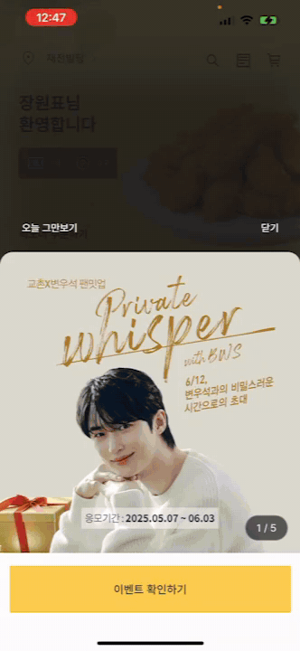</td>
    <td align="center" width="33%">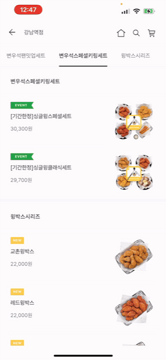</td>
    <td align="center" width="33%">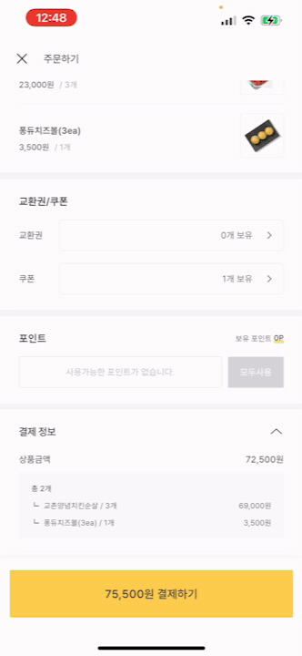</td>
  </tr>
  <tr>
    <td align="center">Pickup or delivery → choose a store on the map</td>
    <td align="center">Browse menu → add to cart</td>
    <td align="center">Apply coupon → choose a payment method</td>
  </tr>
</table>

▸ Eupcheonri 382 ordering app (2024.12 – 2025.06)

<table>
  <tr>
    <td align="center" width="33%">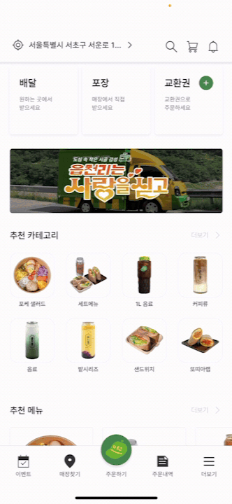</td>
    <td align="center" width="33%">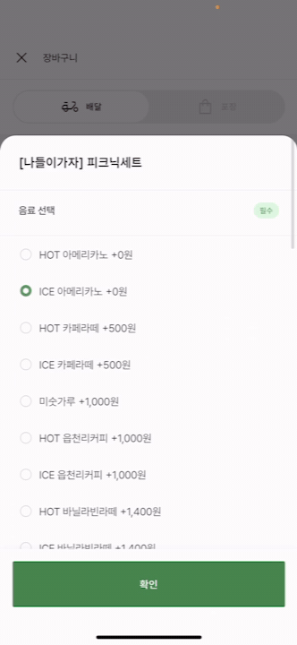</td>
    <td align="center" width="33%">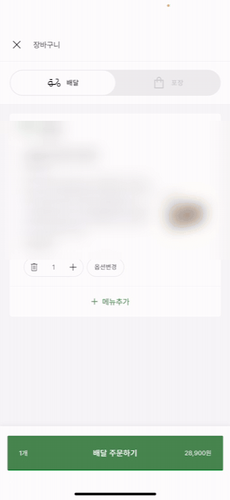</td>
  </tr>
  <tr>
    <td align="center">Browse menu → add to cart</td>
    <td align="center">Set menu options</td>
    <td align="center">Delivery notes → checkout</td>
  </tr>
</table>

**Athenaslab** — *Onul School* app · Client Chapter Lead (2021.08 – 2023.10)
- *Onul School* (1.5M sign-ups): timetable, school meals, academic calendar, and a community with posts, comments and GIF stickers (Flutter, BLoC, RxDart, Injectable, Hive)
- Migrated to a layered architecture with DI and an RxDart global event bus; dynamic board creation, multiple profiles for timetable and community, home summary
- Led a 4-person mobile team: 2-week sprints, OKRs, onboarding docs, code, design and API spec reviews, design system collaboration
- Automated builds and store releases with GitHub Actions + Fastlane; flavor separation to stop dev builds from reaching production; moved from all-at-once to staged rollouts
- Parallel development process with Remote Config feature flags + Git Flow
- Quality monitoring with Crashlytics and Sentry, an event taxonomy for GA and Amplitude, and a built-in log and API call monitor in release-mode dev builds that cut unnecessary API calls

<table>
  <tr>
    <td align="center" width="33%">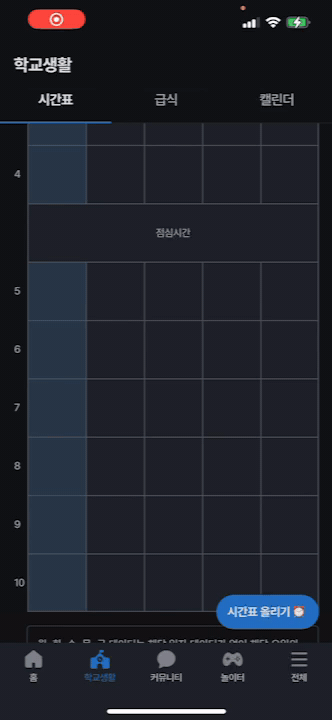</td>
    <td align="center" width="33%">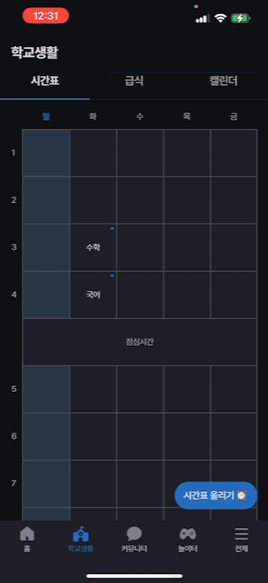</td>
    <td align="center" width="33%">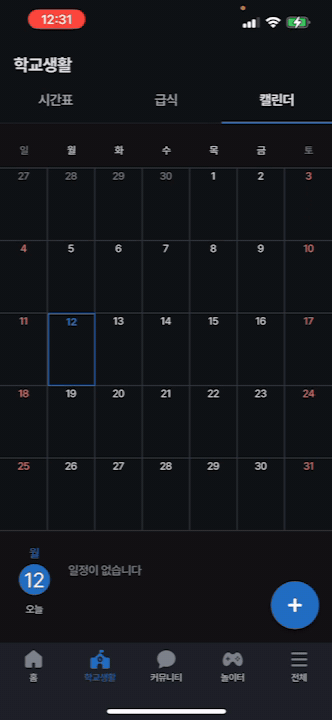</td>
  </tr>
  <tr>
    <td align="center">Add a class to the timetable</td>
    <td align="center">School meals</td>
    <td align="center">Add a personal event to the calendar</td>
  </tr>
</table>

<table>
  <tr>
    <td align="center" width="33%">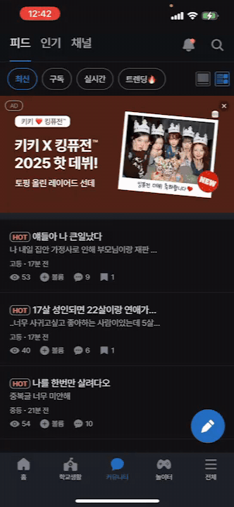</td>
    <td align="center" width="33%">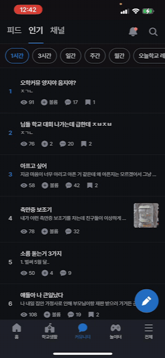</td>
    <td align="center" width="33%">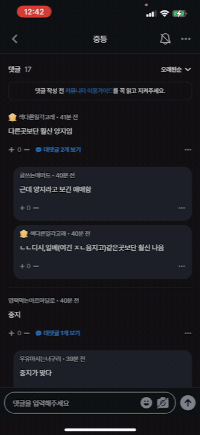</td>
  </tr>
  <tr>
    <td align="center">Community feed</td>
    <td align="center">Poll post</td>
    <td align="center">Comments → write a post</td>
  </tr>
</table>

**ZetServe** — Mobile Engineer (2020.05 – 2021.07)
- RPG-style voice chat app on the Flame game engine + WebRTC (Agora): character interactions and map movement, P2P communication over a Pub/Sub server
- Chat data model across local (SQLite · Moor) and cloud (Firestore) storage, bulletin board
- Launched a webtoon platform in Southeast Asia as a client project the company won

---

### 🛠 Projects

**Scan capture app (personal side project)** — scan history and quality trends, titles and badges, a character to raise, a ladder mini-game, 1:1 chat with clinicians (screens use demo data)

<table>
  <tr>
    <td align="center" width="50%">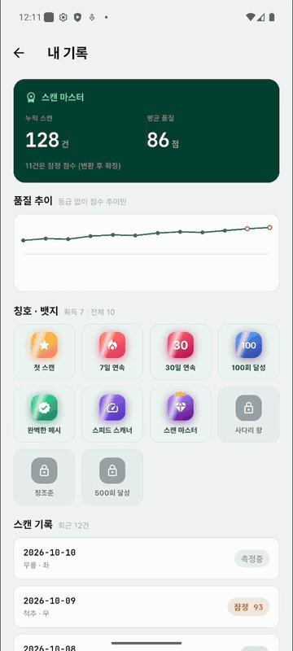</td>
    <td align="center" width="50%">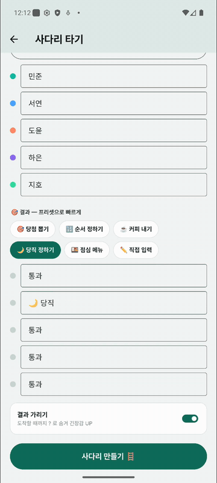</td>
  </tr>
  <tr>
    <td align="center">Badge unlock animation</td>
    <td align="center">Ladder game animation</td>
  </tr>
</table>

<table>
  <tr>
    <td align="center" width="33%">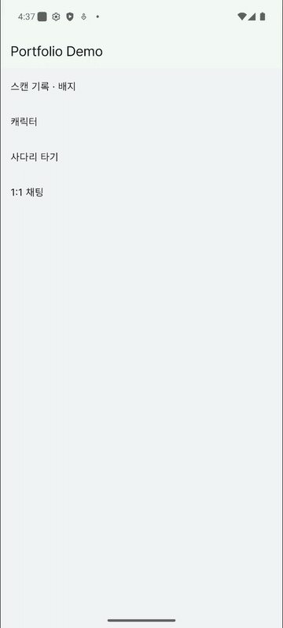</td>
    <td align="center" width="33%">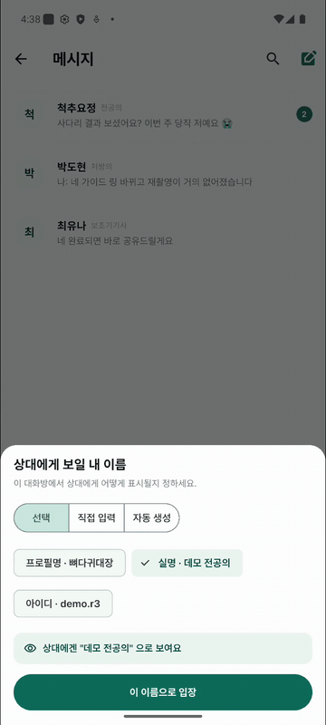</td>
    <td align="center" width="33%">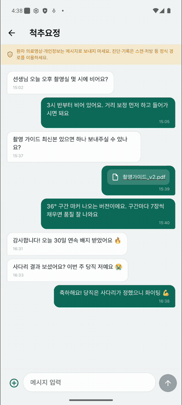</td>
  </tr>
  <tr>
    <td align="center">Choose the display name before entering a chat</td>
    <td align="center">Send messages and files</td>
    <td align="center">Refresh chat list → search messages</td>
  </tr>
</table>

**Admin web** (back office for the scan capture app · Next.js · Prisma · PostgreSQL) — 3D conversion pipeline, operations monitoring, usability feedback, member management (screens use demo data)

<table>
  <tr>
    <td align="center" width="50%">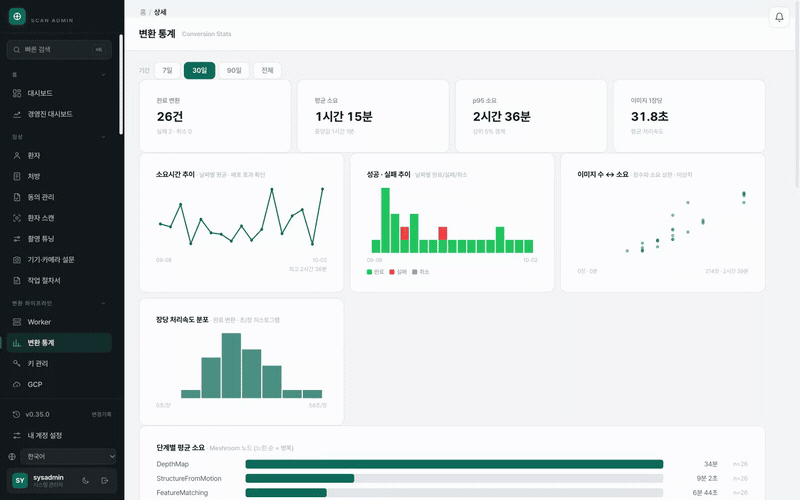</td>
    <td align="center" width="50%">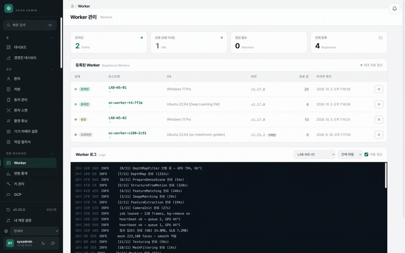</td>
  </tr>
  <tr>
    <td align="center">3D conversion stats — period switch, duration, success rate</td>
    <td align="center">Conversion worker list → details and live logs</td>
  </tr>
  <tr>
    <td align="center" width="50%">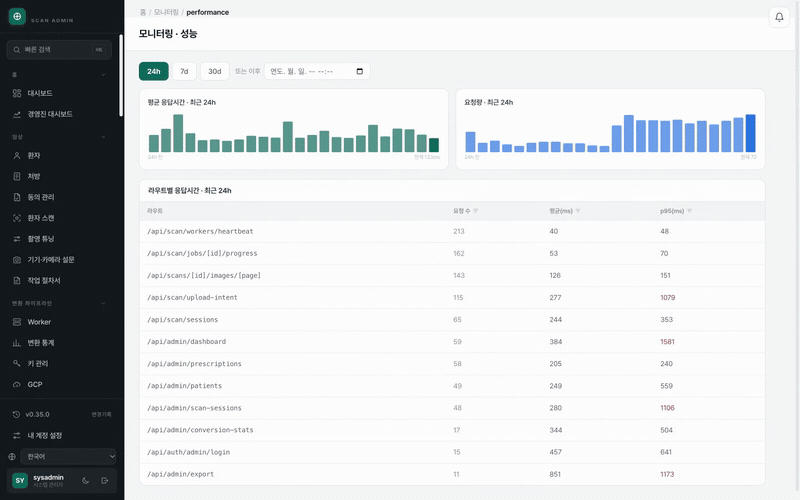</td>
    <td align="center" width="50%">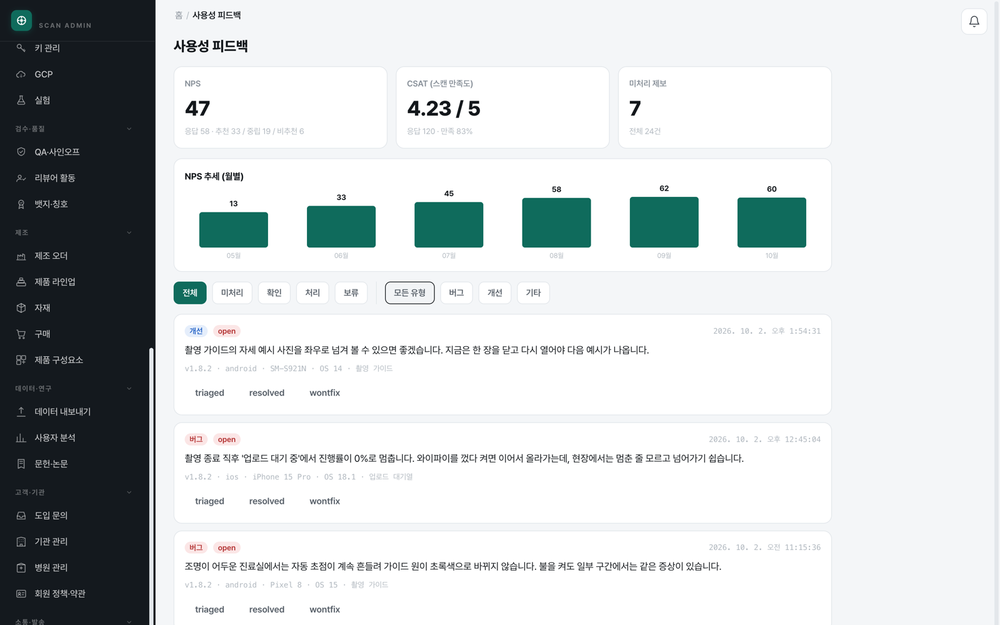</td>
  </tr>
  <tr>
    <td align="center">Response time per route (p95) — period switch</td>
    <td align="center">Usability feedback — NPS and CSAT trends, report handling</td>
  </tr>
  <tr>
    <td align="center" colspan="2">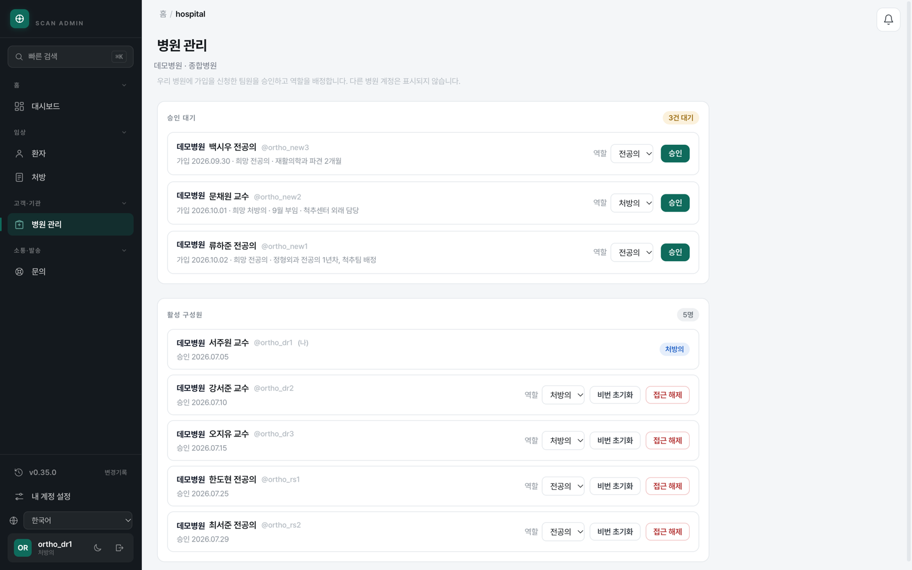</td>
  </tr>
  <tr>
    <td align="center" colspan="2">Member management — sign-up approval, role assignment, access removal</td>
  </tr>
</table>

**[AI emotion-analysis diary app](https://github.com/wonpyoJang/diary_mobile_client)** — Flutter, BLoC, generative AI integration

<table>
  <tr>
    <td align="center" width="33%">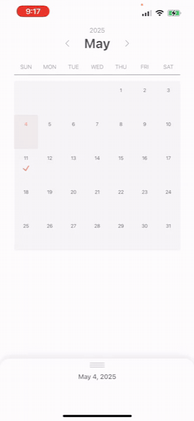</td>
    <td align="center" width="33%">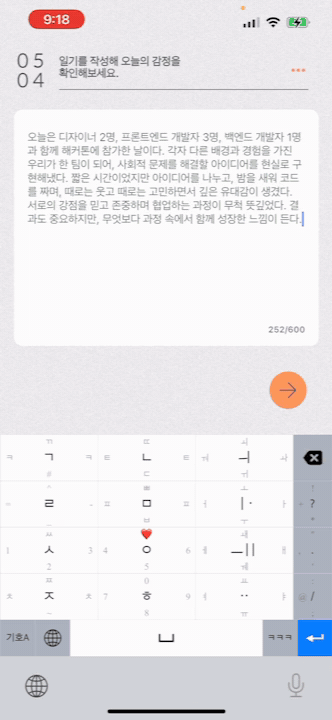</td>
    <td align="center" width="33%">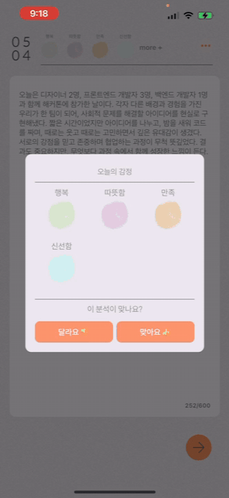</td>
  </tr>
  <tr>
    <td align="center">Write a diary entry</td>
    <td align="center">AI extracts emotions from the entry</td>
    <td align="center">Create an emotion card → save</td>
  </tr>
</table>

**[Analog Timer](https://github.com/wonpyoJang/analog-timer)** — draws segment timers and a stopwatch together on an analog clock face. Flutter (iOS · Android · macOS) + web

<table>
  <tr>
    <td align="center" width="25%">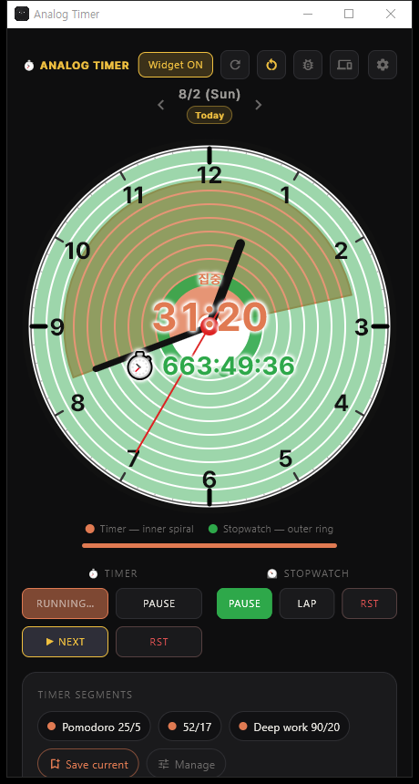</td>
    <td align="center" width="25%">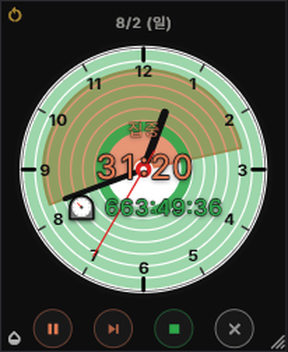</td>
    <td align="center" width="25%">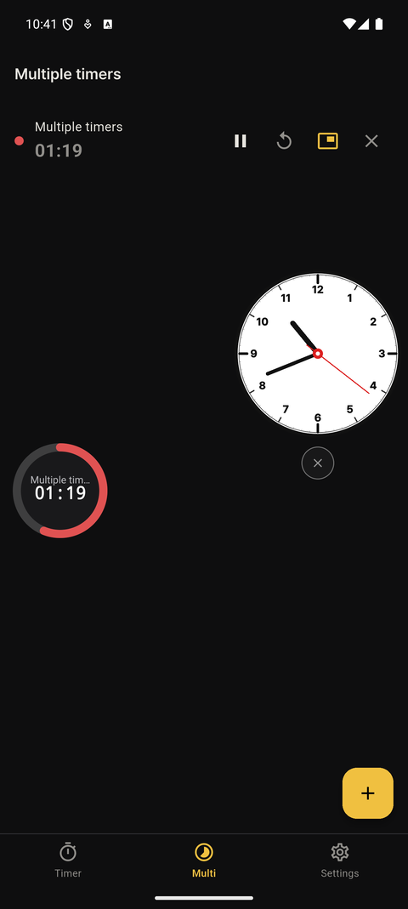</td>
    <td align="center" width="25%">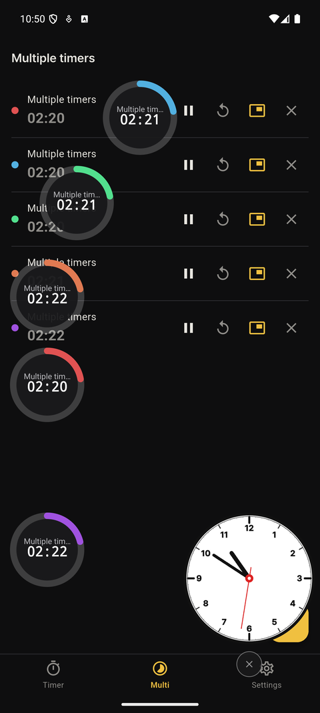</td>
  </tr>
  <tr>
    <td align="center">Desktop — timer ring, stopwatch, segments</td>
    <td align="center">Always-on-top widget mode</td>
    <td align="center">Android overlay clock and timer pill</td>
    <td align="center">Multiple timers at once</td>
  </tr>
</table>

---

### 🎓 Education · Awards

- **University of Seoul**, B.S. in Electrical and Computer Engineering (2014 – 2020) — research assistant at the Parallel Software Lab, teaching assistant for Microprocessors
- **National Supercomputing Competition, awarded 3 times** (KISTI · UNIST) — Excellence Award 2016, Grand Prize 2017 · 2018 (multi-process parallel acceleration with OpenMPI)
- **Fintech × Insurtech Hackathon, Excellence Award** (KISA, 2019) — driving score calculation on Hyperledger Fabric (Flutter · Node.js · GCP)
- **ETRI summer intern** (2019) — performance analysis of on-board speech recognition (Kaldi) for vehicles
- Industrial Engineer Information Processing certificate · Army information security specialist (security monitoring support for the 2018 PyeongChang Olympics)

---

### 📫 Contact

For hiring or collaboration, please reach out by email.

- Email: jangwonpyo0@gmail.com
- Instagram: [@dev.logos](https://www.instagram.com/dev.logos)
